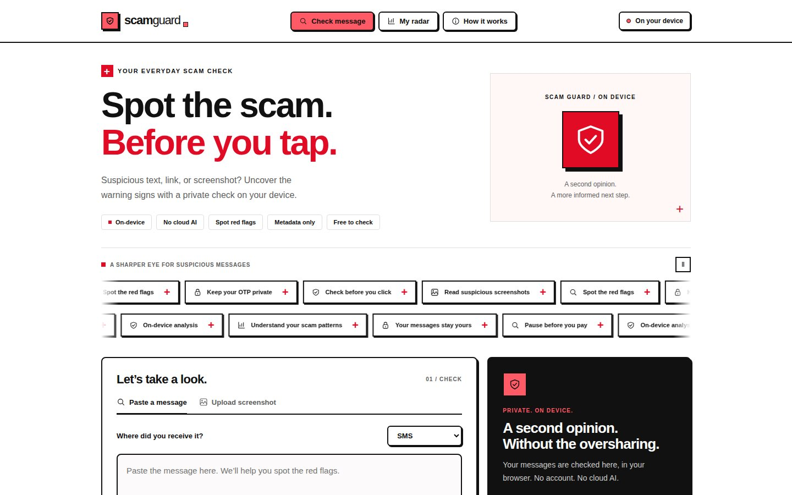

# Scam Guard

> AppBuilders PH Hackathon 2026 · Local AI

A private scam-message checker for everyday Filipinos. Paste a message, inspect understandable red flags, and track your encounters in a personal radar. Messages are processed on your device because private conversations should not need a cloud AI service to check them.

The interface uses white surfaces, black Helvetica/Arial system type, and a vivid red accent that appears on hover and for risk results. It is vanilla JavaScript with Vite, with no external fonts or analytics. A slow, pausable marquee, restrained icon accents, and reduced-motion support keep the checker central.

## Why does this product benefit from running AI locally?

A suspicious message is rarely harmless to share. It can carry names, phone numbers, bank or e-wallet details, and OTP prompts, and the people who check them are often worried relatives or students who do not want to paste that into a cloud service. Scam Guard runs its screenshot reading (Tesseract OCR) and its optional semantic model (MiniLM embeddings) in the browser, so the message never has to be uploaded to be checked. There is no account, no API key and no per-check cost. After the one-time setup downloads, the app is designed to keep working on a weak or interrupted connection, which matters for everyday mobile data in the Philippines (still to be confirmed on the demo device, see [test results](docs/TEST_RESULTS.md)).

## Run locally

Requires a recent Node.js version (tested with Node 22 and 24). Step-by-step instructions for Windows, macOS and Linux are in [docs/RUN_LOCALLY.md](docs/RUN_LOCALLY.md).

```sh
npm ci
npm run setup:ocr
npm run dev
```

`npm ci` copies installed ONNX/Tesseract runtime files and generates icons. `setup:ocr` downloads the official Tesseract English language data (about 4 MB), records its source/checksum, and saves its license. This is an inbound model download, not a cloud OCR call.

English OCR data is downloaded and verified in this checkout. On machines that need their system certificate store, use `node --use-system-ca scripts/download-ocr.mjs`; never disable TLS verification.

Click **Enable local AI** to download the pretrained quantized `Xenova/all-MiniLM-L6-v2` embedding model. No LLM training is needed. Rules run immediately without it. The model is primarily English; Tagalog and Taglish are supported through rules/examples, with semantic quality not yet measured.

## Verify and build

```sh
npm test
npm run build
npm run preview -- --host 127.0.0.1
```

21 automated tests cover rule controls, OTP negations, URL host checks, fallback scores, local dates, metadata privacy, backup validation, deduplication, and demo isolation. These are synthetic regression tests, not a real-world accuracy benchmark. See [test results](docs/TEST_RESULTS.md).

Production builds register a service worker. The app shell and bundled OCR assets are precached; large ONNX runtime assets cache when loaded. Transformers.js manages the downloaded model cache. Open the production preview online, let caching finish, enable the model, and test with your actual connection disabled. **A dev-server preview is not proof of offline reload support.**

The **Use cached assets only** setting blocks model fetches that are not in the browser cache and checks OCR readiness. It does not turn off the device's connection. Browser cache eviction can require setup again. Offline reload and installed-PWA share targeting still require a device test before claiming a completed hackathon demo.

## What works

- Paste checks, source selection, English/Tagalog explanations, editable screenshot flow, link warnings, and highlighted evidence.
- Local embedding inference in a Web Worker with WebGPU/WASM fallback and visible readiness/errors.
- Private IndexedDB metadata history, 53-week heatmap, daily drilldown, statistics, labeled removable demo records.
- Metadata JSON backups with validated, non-destructive, deduplicated imports.
- Responsive desktop/mobile layout and PWA build configuration.

Message text is not saved by default. Exports exclude raw messages and settings. Suspicious links are displayed as text and are never fetched. Scores are heuristics, not probabilities or guarantees. Scams can be missed and legitimate messages can be flagged.

Pretrained-model calibration is not included. See [disclosures](docs/DISCLOSURES.md) for the implementation and current limits.

## Release documentation

- [Run it locally](docs/RUN_LOCALLY.md)
- [Publish to GitHub](docs/GITHUB_PUBLISH.md)
- [Submission checklist and demo script](docs/SUBMISSION.md)
- [Build and publishing guide](docs/PUBLISHING.md)
- [Architecture](docs/CONTEXT.md)
- [Disclosures](docs/DISCLOSURES.md)

## Hackathon submission

All fields required by the AppBuilders PH checklist (project, proof, disclosures) are collected in [docs/SUBMISSION.md](docs/SUBMISSION.md).

## License

[MIT](LICENSE) for the application code. Third-party packages, the Tesseract English language data and the Xenova/all-MiniLM-L6-v2 model keep their own licenses.




